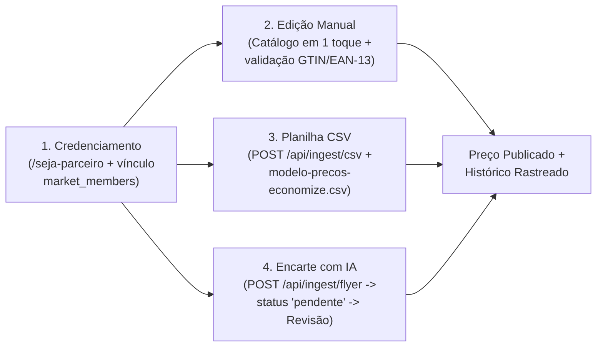

# Relatório de Evolução e Entrega do MVP — Economize+

> [!TIP]
> **Resumo Rápido (Pronto para copiar e enviar no WhatsApp / Slack da equipe):**
>
> Pessoal, concluímos a evolução completa do MVP do **Economize+**! O que entrou no ar:
> 1. **100% Dados Reais e Rastreáveis:** Fim de qualquer dado fictício; todo preço agora exige fonte (`Parceiro`, `CSV`, `Encarte IA`, `Coleta em Loja`) e horário exato da coleta, com aviso automático para preços com mais de 7 dias.
> 2. **Cadastro Real de Consumidores e Recuperação de Senha (`/conta`):** Cadastro completo com Nome, E-mail, Telefone/WhatsApp, busca automática de CEP (preenchendo Cidade e Bairro), edição de perfil e fluxo completo de redefinição de senha via Supabase Auth.
> 3. **Histórico de Atualização de Preços (`/api/precos/historico`):** Linha do tempo nas páginas de produto, mercado e painel do parceiro mostrando se o preço subiu (`↑`), baixou (`↓`) ou se manteve (`=`), com o valor anterior e a data/hora de cada coleta.
> 4. **Fluxo Oficial de Cadastro e Atualização de Preços para Mercados (`/seja-parceiro` e `/painel-parceiro`):** Guia passo a passo em 4 etapas, download do modelo oficial de planilha (`modelo-precos-economize.csv`), validação de código de barras GTIN/EAN e leitura de encartes com IA + revisão humana obrigatória antes de publicar.
> 5. **Central de QR Code de Divulgação e Cartaz (`/divulgacao`):** Gerador automático de QR Code (SVG e PNG) e Cartaz Oficial (`1080×1350px`) pronto para impressão de balcão/caixa ou postagem nas redes sociais assim que o link de demonstração/produção é aberto.
> 6. **Acabamento Mobile/Desktop, SEO e Material de Lançamento:** Ícone circular oficial da marca, animações fluidas a 60fps nas barras de navegação (Desktop e Mobile), `sitemap.xml`/`robots.txt`, vídeos de lançamento (16:9 e 9:16 Shorts/Reels) e Manual Digital Interativo (`/material-digital-economize.html`).

---

## 1. Identidade Visual, Navegação e Experiência Mobile-First
- **Ícone Circular Oficial e Identidade da Marca:** Aplicado o logotipo circular oficial do **Economize+** na aba do navegador (`favicon.ico`), ícone de aplicativo (`icon-192.png`, `icon-512.png`, `apple-icon.png`), cabeçalho e rodapé, utilizando a paleta oficial (`#063A6B` Azul Institucional, `#00AFCF` Azul Ação, `#52D95D` Verde Economia e `#FFC928` Amarelo Oferta).
- **Animações de Navegação 60fps (Desktop e Celular):**
  - Na barra superior de categorias ([`AnimatedSubnav.tsx`](file:///c:/Users/leywin/Downloads/economize/src/components/AnimatedSubnav.tsx)): pílula branca deslizante que acompanha o clique e o cursor entre as abas.
  - Na barra inferior fixa do celular ([`MobileBottomNav.tsx`](file:///c:/Users/leywin/Downloads/economize/src/components/MobileBottomNav.tsx)): indicador deslizante animado com ícone em destaque, micro-interação de toque e alvos clicáveis de no mínimo `44×44px`.

---

## 2. Cadastro Real de Consumidores, Autenticação e Recuperação de Senha
- **Cadastro Completo (`/conta` + [`/api/conta/perfil`](file:///c:/Users/leywin/Downloads/economize/src/app/api/conta/perfil/route.ts)):**
  - Coleta e armazena na tabela `public.profiles` ([`0002_consumidor_historico.sql`](file:///c:/Users/leywin/Downloads/economize/supabase/migrations/0002_consumidor_historico.sql)): **Nome Completo, E-mail, Telefone/WhatsApp, CEP, Bairro, Cidade e Consentimento LGPD com data/hora**.
  - Ao digitar os 8 números do CEP, o sistema consulta automaticamente a rota [`/api/cep/[cep]`](file:///c:/Users/leywin/Downloads/economize/src/app/api/cep/%5Bcep%5D/route.ts), preenche **Cidade** e **Bairro** e já sincroniza o raio de localização do usuário.
- **Edição de Perfil e Sincronização de Lista:**
  - Consumidores autenticados contam com o painel **"Meus Dados Cadastrais de Consumidor"** para atualizar seus dados a qualquer momento e sincronizar sua **Lista de Compras Inteligente** na nuvem.
- **Recuperação e Alteração de Senha Completa ([`src/app/conta/page.tsx`](file:///c:/Users/leywin/Downloads/economize/src/app/conta/page.tsx)):**
  - Envio de link de recuperação por e-mail (`resetPasswordForEmail` com redirecionamento para `/conta?mode=redefinir`).
  - Detecção automática do evento `PASSWORD_RECOVERY` do Supabase Auth, abrindo o formulário **"Definir Nova Senha"** (`supabase.auth.updateUser`) para concluir a redefinição sem sair do site.
  - Card de **Alteração de Senha** também disponível dentro da conta logada.

---

## 3. Histórico de Atualização de Preços (`public.price_history`)
- **Rastreabilidade Automática no Banco:**
  - Toda inserção ou alteração de preço publicado em `public.market_prices` dispara automaticamente a trigger `trg_log_price_history`, gravando o registro em `public.price_history`.
- **Nova API e Linha do Tempo Visual ([`/api/precos/historico`](file:///c:/Users/leywin/Downloads/economize/src/app/api/precos/historico/route.ts) + [`PriceHistorySection.tsx`](file:///c:/Users/leywin/Downloads/economize/src/components/PriceHistorySection.tsx)):**
  - Integrado na **página do produto** ([`/produto/[id]`](file:///c:/Users/leywin/Downloads/economize/src/app/produto/%5Bid%5D/page.tsx)), na **página pública do mercado** ([`/mercados/[id]`](file:///c:/Users/leywin/Downloads/economize/src/app/mercados/%5Bid%5D/page.tsx)) e no **Painel do Parceiro** ([`/painel-parceiro`](file:///c:/Users/leywin/Downloads/economize/src/app/painel-parceiro/page.tsx)).
  - Calcula e exibe para cada coleta:
    - Preço atual e preço anterior (`Antes: R$ X,XX`)
    - Selo de variação: `↓ Baixou R$ X,XX`, `↑ Subiu R$ X,XX`, `= Preço mantido` ou `1º registro`
    - Origem rastreável (`Painel do Parceiro`, `Planilha CSV`, `Encarte OCR Revisado`, `Coleta da Equipe`) e data/hora completa (`DD/MM/AAAA às HH:mm`).

---

## 4. Como os Mercados Cadastram e Atualizam os Preços
Foi estruturado e integrado o guia operacional completo ([`MarketOnboardingGuide.tsx`](file:///c:/Users/leywin/Downloads/economize/src/components/MarketOnboardingGuide.tsx)) em [`/seja-parceiro`](file:///c:/Users/leywin/Downloads/economize/src/app/seja-parceiro/page.tsx) e [`/painel-parceiro`](file:///c:/Users/leywin/Downloads/economize/src/app/painel-parceiro/page.tsx) definindo as **4 etapas oficiais**:

1. **Etapa 1 — Credenciamento e Vínculo Seguro:** O supermercado solicita cadastro em `/seja-parceiro` (com preenchimento automático de endereço por CEP). Após aprovação no `/admin`, o responsável recebe vínculo em `public.market_members`, protegido por Row Level Security (RLS).
2. **Etapa 2 — Cadastro e Atualização Manual Rápida:** No `/painel-parceiro`, o lojista altera preços existentes com 1 clique, confirma itens com mais de 7 dias ou cadastra novos produtos com validação do dígito verificador **GTIN-8/12/13/14** e cálculo automático de `R$/kg` e `R$/L`.
3. **Etapa 3 — Importação em Lote via Planilha CSV (`POST /api/ingest/csv`):** Botão **"Baixar Modelo CSV (`modelo-precos-economize.csv`)"** disponível diretamente na tela para o mercado exportar do seu ERP/PDV no padrão `ean,nome,preco,oferta` e atualizar até 5.000 itens por envio.
4. **Etapa 4 — Leitura de Encartes por IA com Revisão Humana (`POST /api/ingest/flyer` + `PATCH /api/ingest/review`):** O mercado envia a foto ou PDF do encarte; o Gemini Vision extrai os produtos e preços, que entram obrigatoriamente com `status = 'pendente'` até que o gerente revise e aprove na fila de revisão.

---

## 5. QR Code de Divulgação e Kit de Marketing (`/divulgacao`)
- **Central de Divulgação ([`src/app/divulgacao/page.tsx`](file:///c:/Users/leywin/Downloads/economize/src/app/divulgacao/page.tsx) + [`QrCodePromoCard.tsx`](file:///c:/Users/leywin/Downloads/economize/src/components/QrCodePromoCard.tsx)):**
  - Detecta automaticamente o endereço ativo do site (ou permite digitar qualquer URL de demonstração/produção).
  - Permite gerar QR Codes específicos para a **Página Inicial (`/`)**, **Busca e Leitor EAN (`/buscar`)**, **Lista Inteligente (`/lista`)**, **Credenciamento de Parceiros (`/seja-parceiro`)** ou para a **Página Exclusiva de um Supermercado (`/mercados/[id]`)**.
  - Exporta **QR Code Vetorial (SVG)** e gera automaticamente um **Cartaz Oficial de Balcão/Caixa em Alta Resolução (`1080×1350px` PNG)** com logotipo circular, passo a passo para o cliente e botão de impressão direta (`window.print()`).

---

## 6. Vídeos de Lançamento, Material Digital e SEO Técnico
- **Vídeos Explicativos (Gerados em Código com Remotion):**
  - Versão Widescreen (`1920×1080`, 24s): [`public/video-lancamento-economize.mp4`](file:///c:/Users/leywin/Downloads/economize/public/video-lancamento-economize.mp4)
  - Versão Vertical Shorts/Reels/TikTok/WhatsApp (`1080×1920`, 18s): [`public/video-shorts-economize.mp4`](file:///c:/Users/leywin/Downloads/economize/public/video-shorts-economize.mp4)
- **Material Digital Interativo:**
  - Disponível em [`public/material-digital-economize.html`](file:///c:/Users/leywin/Downloads/economize/public/material-digital-economize.html) com simulador interativo de `R$/kg` e simulador da **Lista de Compras Inteligente** (demonstrando a separação entre Cestas Completas e Cestas Parciais sem somar item em falta como `R$ 0,00`).
- **SEO Técnico (`OpenSEO`):**
  - Adicionados [`src/app/sitemap.ts`](file:///c:/Users/leywin/Downloads/economize/src/app/sitemap.ts) e [`src/app/robots.ts`](file:///c:/Users/leywin/Downloads/economize/src/app/robots.ts) indexando todas as páginas públicas e protegendo rotas administrativas e de API.

---

## 7. Checklist Rápido para o Administrador (Banco de Dados)
- [x] Migration [`0001_dados_reais.sql`](file:///c:/Users/leywin/Downloads/economize/supabase/migrations/0001_dados_reais.sql) aplicada no Supabase.
- [ ] Executar a nova migration complementar [`supabase/migrations/0002_consumidor_historico.sql`](file:///c:/Users/leywin/Downloads/economize/supabase/migrations/0002_consumidor_historico.sql) no **SQL Editor** do Supabase para liberar as colunas extras de contato/endereço (`phone`, `cep`, `neighborhood`, `city`, `lgpd_consent`) na edição de perfil dos consumidores.
